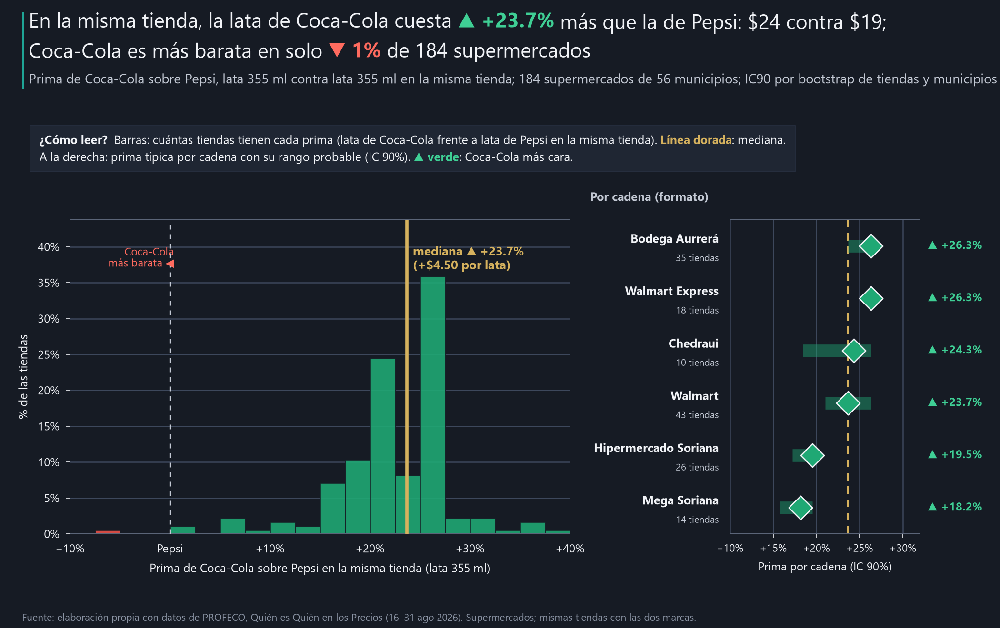

# ¿Cuánto vale la marca Coca-Cola en pesos?

**Objetivo.** Medir con precios reales cuánto sobreprecio sostiene la marca líder frente a su competidor directo, como caso de valor de marca para directores de marketing y ventas.

**En la misma tienda, ¿cuánto más cuesta Coca-Cola que Pepsi en presentación equivalente?**

**El problema.** Una marca líder suele sostener un precio más alto que su competidor, pero ese sobreprecio no es una sola cifra: depende de la presentación que se compara y de la unidad (por lata, por litro o por envase). Para decisiones de precio y de portafolio importa saber dónde se sostiene y dónde se diluye.

**[Ver el análisis interactivo](https://ernestrr.github.io/mexico-prima-coca-cola/)** · [Infografía](publicacion/infografia_coca_cola_pepsi.png)

## El hallazgo principal

**En la misma tienda, la lata de Coca-Cola cuesta 23.7% más que la de Pepsi (IC90 21.4–24.7%): $24 contra $19, una diferencia típica de $4.50 por lata.** Coca-Cola es más barata que Pepsi en solo 1% de los 184 supermercados que tienen las dos latas, y la prima es sólida en las 6 cadenas con datos suficientes.



Prima = cuánto más cuesta Coca-Cola que Pepsi en la misma tienda (mediana de las tiendas). IC90 = rango probable, por bootstrap de tiendas y municipios. Se habla de precio relativo sostenido, no de valor contable de la marca.

## Tres hallazgos de apoyo

1. **La prima vive en el envase individual.** En la botella familiar (Coca-Cola 2.75 L contra Pepsi 3 L) la prima baja a 4.9% por litro (IC90 4.9–4.9%), y por botella la Coca-Cola cuesta −3.8% frente a la Pepsi ($46.90 contra $51.95; más barata en 79% de las tiendas): un envase un poco más chico que llega a un precio menor. Un litro de Coca-Cola en lata cuesta $67.61, 3.9 veces lo que en la botella de 2.75 L ($17.16).
2. **Todas las cadenas sostienen la prima de la lata, pero no la misma.** Va de 18.2% en Mega Soriana y 19.5% en Hipermercado Soriana (IC90 17.2–19.5) a 26.3% en Bodega Aurrerá (IC90 23.7–26.3) y Walmart Express. Por región, de 21.1% en el Centro Norte a 25.0% en el Centro.
3. **La prima se reduce o se invierte en la botella, no en la lata.** La lata de Coca-Cola queda a menos de la mitad de la prima típica en 3% de las tiendas y es más barata en 1%. En la botella familiar, Coca-Cola sale más barata por litro en 21% de las tiendas. Que una tienda tenga prima baja en una presentación no dice nada de la otra (correlación de rangos −0.04): cada envase tiene su propia política.

**Lo que no resultó sólido.** En Bodega Aurrerá la botella de Coca-Cola sale más barata por litro que la de Pepsi en 63% de las tiendas (prima típica −5.6%), pero el rango probable va de −5.6% a 0.2% y cruza 0: no se puede afirmar que Bodega invierta la prima. Las variantes light muestran una prima mayor (33.2% por litro), pero solo hay 36 tiendas con las dos. Y no hay Pepsi de 600 ml en el archivo: la presentación más vendida de Coca-Cola ($22, en 280 supermercados) no tiene par.

## Qué significa para el negocio y qué hacer

Aplica a los supermercados que monitorea PROFECO, no a todo el mercado. Solo precio al consumidor: no hay ventas, volumen ni margen, así que no se mide cuánto vende cada marca con esa prima.

**Dirección de marketing y ventas de la marca líder**
- **La prima se sostiene donde el cliente compra por impulso.** En la lata, 24% arriba de Pepsi y casi sin excepciones (1% de tiendas invertidas): ese es el activo de marca que hay que cuidar.
- **En el envase familiar la marca compite por precio de empaque.** La botella de 2.75 L cuesta menos que la Pepsi de 3 L en 79% de las tiendas. Si el objetivo es margen por litro, ahí está el espacio; si es volumen, la estrategia ya funciona.
- **Revise las cadenas con prima más baja en lata.** En Soriana la prima es 20% contra 26% en Bodega Aurrerá: la diferencia de anaquel la decide la cadena.

**Marca retadora**
- **No pelee la lata solo con precio.** Pepsi ya está $4.50 abajo en casi todas las tiendas y la líder sostiene su prima; la palanca está en visibilidad, frío y punto de venta.
- **Compita en el formato familiar con precio por litro visible.** Ahí la diferencia por litro es de 5% y el cliente compara empaques de tamaños distintos: hacer visible el precio por litro favorece a la botella de 3 L.
- **Busque presentaciones donde la líder no tiene par.** Coca-Cola de 600 ml no tiene competidor directo de Pepsi en el archivo.

**Dueño de tienda o cadena**
- **Use la lata para margen y la botella para tráfico.** El cliente acepta una prima de 24% en la lata de la líder; en el envase familiar compara precio por empaque.
- **Muestre el precio por litro.** Con envases de 2.75 L y 3 L, el precio por botella engaña; la etiqueta por litro ayuda al cliente y reduce reclamos.

**Analista comercial**
- **Compare en la misma tienda y en presentación equivalente.** El promedio nacional de cada marca mezcla tiendas, ciudades y tamaños.
- **Con tamaños distintos, reporte por litro y por empaque.** Por litro Coca-Cola sale 4.9% más cara; por botella, −3.8%: las dos lecturas son ciertas y dicen cosas distintas.

## Cómo se hizo (breve)

- Precios de tienda (mediana de la quincena) de supermercados monitoreados por PROFECO del 16 al 31 de agosto de 2026.
- Pares Coca-Cola–Pepsi en la misma tienda (motor `pares.marcas`): lata 355 ml contra lata 355 ml (184 tiendas, 56 municipios); Coca-Cola 2.75 L contra Pepsi 3 L por litro y por botella (144 tiendas); Light 2 L contra Light 2.5 L por litro (36 tiendas).
- Prima = mediana de log(precio Coca-Cola / precio Pepsi) en %, y mediana de la diferencia en pesos; IC90 por bootstrap de tiendas y municipios (500 réplicas, semilla 2026).
- Desglose por cadena, formato, grupo y región con 10 tiendas o más.

## Limitaciones

- **Universo:** solo tiendas monitoreadas por PROFECO; no es una muestra representativa de todos los establecimientos.
- **Periodo:** una quincena (16–31 ago 2026); las promociones de un día quedan atenuadas por la mediana de la quincena.
- **Presentaciones:** no hay Pepsi de 600 ml; la botella familiar compara tamaños distintos (2.75 L y 3 L).
- **Precios discretos:** muchas tiendas cobran exactamente lo mismo ($24 y $19 en la lata); por eso algunos rangos probables tocan la estimación en un extremo.
- **Causalidad:** la prima describe precios relativos; no dice cuánto vende cada marca ni por qué la cadena fija esos precios.

## Datos y cobertura

- **Fuente oficial:** PROFECO, programa Quién es Quién en los Precios (https://qqp.profeco.gob.mx/), archivo `08-2026_Q2.csv`.
  La huella SHA-256 del original está en `data/metadata/manifiesto_insumos.json`; el archivo no se modifica.
- **Periodo:** 16 al 31 de agosto de 2026 (una quincena).
- **Cobertura:** supermercados y tiendas de autoservicio monitoreados por PROFECO. Lata: 184 tiendas en
  56 municipios; botella familiar: 144 tiendas en 40 municipios;
  variantes light: 36 tiendas en 18 municipios.

## Definiciones y criterios de comparabilidad

- **Misma tienda:** cada precio de Coca-Cola se compara con el de Pepsi en el mismo establecimiento, así que la cadena, la
  ciudad y la tienda no explican la diferencia. El precio de una tienda es la mediana de sus observaciones de la quincena.
- **Prima de precio:** cuánto más cuesta Coca-Cola que Pepsi, en % (mediana de log(precio Coca-Cola / precio Pepsi) entre
  tiendas) y en pesos. Positiva (▲, verde): Coca-Cola más cara; negativa (▼, rojo): más barata.
- **Presentaciones equivalentes:** lata de 355 ml contra lata de 355 ml (mismo tamaño). Coca-Cola 2.75 L contra Pepsi 3 L:
  los tamaños no coinciden (razón 0.92), por eso se reporta por litro y por botella. Las variantes light (2 L contra 2.5 L)
  son solo una sensibilidad. No hay Pepsi de 600 ml, así que esa presentación de Coca-Cola no tiene par.
- **Por litro y por botella** miden cosas distintas: por litro se compara el contenido; por botella, lo que se paga en la
  caja. Ninguna de las dos implica disposición a pagar, margen ni causalidad.
- **Incertidumbre:** IC90 (rango probable) por bootstrap de tiendas y municipios, 500 réplicas, semilla 2026.

## Tecnologías utilizadas

- **Análisis:** Python 3.13, pandas, NumPy, PyArrow (Parquet) y PyYAML; Jupyter (nbformat, nbclient) para los notebooks.
- **Gráficas:** matplotlib para las del análisis; Plotly y Kaleido para el reporte interactivo, la infografía y la animación.
- **Animación:** Pillow, imageio y FFmpeg.
- **Verificación:** `verify_project.py` y `tests/validar_publicacion.py` (solo pandas, NumPy y la biblioteca estándar).

## Método

**00 · Datos y equivalencias.** Tabla común `precio_tienda_sku` unida a `tiendas` y `sku_catalogo`. Pepsi regular solo viene en
lata de 355 ml y botellas de 2.5 y 3 L; no hay Pepsi de 600 ml. Empresa propietaria verificada en `sku_catalogo` (Form 10-K de
cada empresa). Posibles errores, extremos y precios que cambian en la quincena se marcan.

**01 · Prima en la misma tienda.** `pares.marcas` con a = Pepsi y b = Coca-Cola; `pares.resumir` para la prima en % y en pesos,
% invertidos e IC90 de dos vías. Sensibilidad de la lata:

| Variante | Prima |
|---|---|
| Principal (supermercados) | 23.7% |
| Sin extremos, sin precios que cambian en la quincena y todos los giros | entre 23.7% y 24.6% |

**02 · Cadena, formato y región.** Misma prima por grupo con 10 tiendas o más.

**03 · Dónde se reduce.** Invertida = Coca-Cola más barata en la tienda; reducida = prima menor a la mitad de la mediana.
Correlación de rangos (Spearman) entre la prima de la lata y la de la botella en las mismas tiendas.

**04 · Poder de precio.** Precio por litro de cada presentación regular (mediana de los supermercados que la venden, 30 tiendas o
más).

**05 · Visualizaciones.** Gráficas, versiones para publicar y reporte interactivo.

## Fuentes

Todas las gráficas y cifras son **elaboración propia con datos de PROFECO**. Convención de color por signo: verde = valor positivo (▲); rojo = valor negativo (▼). Dorado marca referencias.

- **The Coca-Cola Company**, Form 10-K 2025 (propiedad de la marca Coca-Cola): https://www.sec.gov/Archives/edgar/data/21344/000162828026010047/ko-20251231.htm
- **PepsiCo, Inc.**, Form 10-K 2025 (propiedad de la marca Pepsi): https://www.sec.gov/Archives/edgar/data/77476/000007747626000007/pep-20251227.htm
- **PROFECO**, Quién es Quién en los Precios: archivo `08-2026_Q2.csv` (16–31 ago 2026). **URL oficial del programa:** https://qqp.profeco.gob.mx/

## Estructura y reproducción

```
mexico-prima-coca-cola/
├── notebooks/        00 datos y equivalencias · 01 prima en la misma tienda · 02 cadena, formato y región
│                     03 dónde se reduce · 04 poder de precio · 05 visualizaciones
├── config.yaml       objetivo, preguntas y textos del README y del reporte
├── src/              entorno.py, prima.py (pares y prima), graficas.py, reporte.py
├── data/processed/   pares por tienda, prima por presentación y cadena, precio por litro (CSV) y resultados.json
├── data/metadata/    parametros.json, manifiesto_insumos.json
├── outputs/charts/   gráficas PNG (la principal también en SVG)
├── outputs/social/   versiones de 1280×720 y 1080×1350
├── docs/index.html   reporte interactivo autocontenido (GitHub Pages)
├── publicacion/      infografía, animación y texto de la publicación (scripts incluidos)
├── tests/            validar_publicacion.py: cifras, enlaces, archivos y datos sensibles
├── build_notebooks.py
└── verify_project.py
```

```powershell
python -m pip install -r requirements.txt
python build_notebooks.py
$env:OMP_NUM_THREADS = 1; $env:OPENBLAS_NUM_THREADS = 1; $env:MKL_NUM_THREADS = 1
foreach ($n in Get-ChildItem notebooks/0*.ipynb) {
  python -m jupyter nbconvert --to notebook --execute --inplace --ExecutePreprocessor.timeout=1800 $n.FullName
}
python verify_project.py
python tests/validar_publicacion.py
```

`verify_project.py` recalcula las cifras clave solo con pandas y numpy a partir de los precios originales y comprueba que
coinciden con este README. `tests/validar_publicacion.py` revisa que el HTML, la infografía y el texto de la publicación
usen esas mismas cifras.

Materiales de `publicacion/` (opcionales, requieren Kaleido): `python publicacion/generar_infografia.py` y `python publicacion/generar_gif.py` (la animación tarda unos 10 minutos).


---

**Autor:** Ernesto Roldán | Business Intelligence & Analytics | Inteligencia económica aplicada a pricing y rentabilidad
